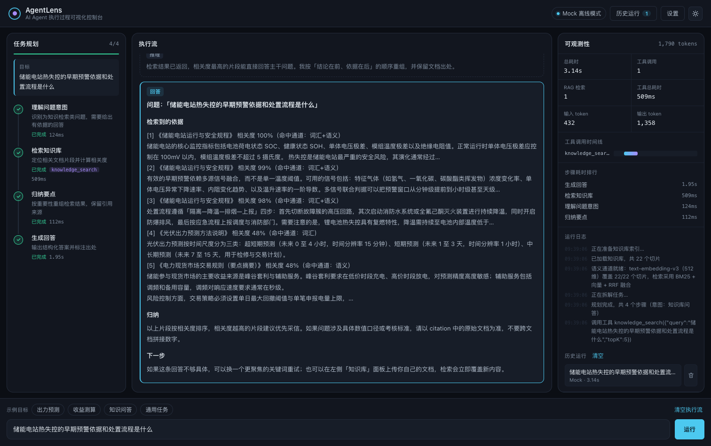
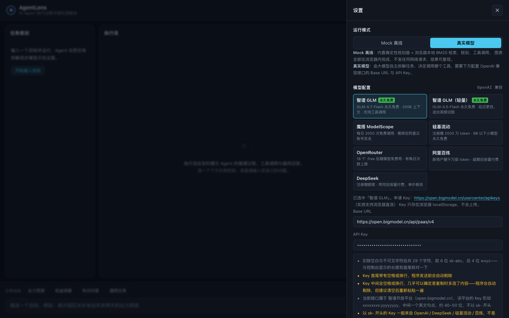
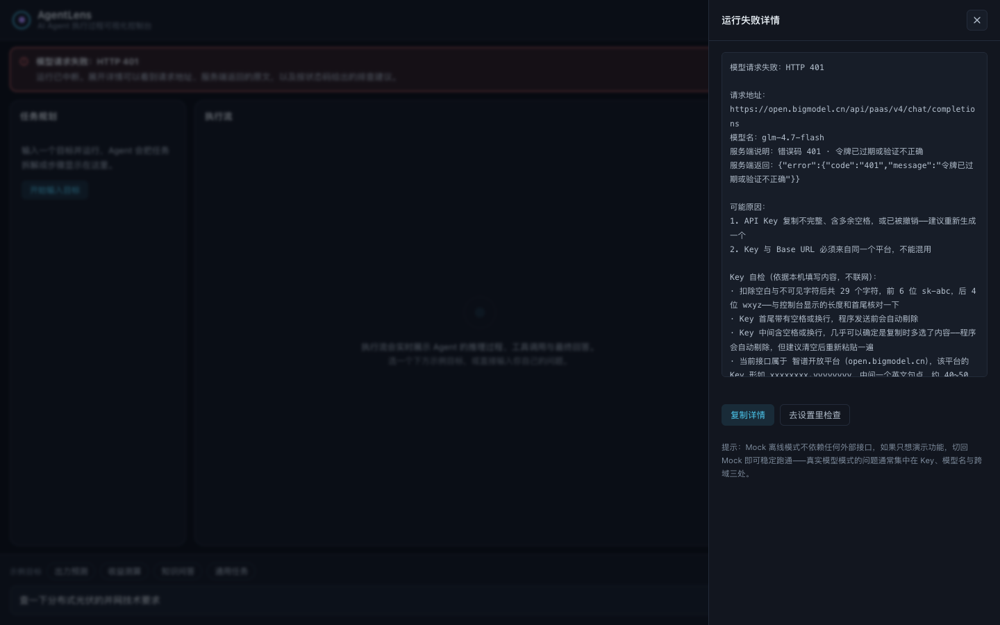

# AgentLens · AI Agent 执行过程可视化控制台

> 把「黑盒」的 Agent 调用变成可观察、可复盘、可解释的过程。
>
> 一个面向 AI 应用开发的**前端工程化**项目：规划可视化 + 工具调用链路 + 混合检索可观测 + 执行流录制。

<p>
  
  
  
  
  
</p>

**在线演示**：<!-- 部署后替换 --> 待部署



上图是一次真实的 RAG 问答运行：每条引用都标注了命中通道（`词汇` / `语义` / `词汇+语义`），右侧面板同步给出检索次数、工具耗时、token 计量与逐条运行日志。

---

## 这个项目解决什么问题

做 AI 应用时，最痛苦的不是「调不通模型」，而是**调通了但不知道为什么**：

- 用户问了一个问题，模型答错了。是**检索没召回**？**提示词没说清**？还是**模型能力边界**？
- Agent 执行了 5 轮工具调用，中间哪一轮耗时最长？哪一轮参数传错了？
- 这次改完提示词效果变好了，**上一次的链路长什么样**？想对比，但没留证据。

大多数 AI 应用的界面只给一个输入框和一个回答框 —— 中间发生了什么，全靠猜。

**AgentLens 把中间过程全部摊开**：规划步骤、每一条推理、每一次工具调用的入参出参与耗时、检索命中的切片与双通道分数、token 消耗与端到端耗时，并且把整条链路录下来供复盘。

---

## 功能

### 1. 任务规划可视化
Agent 先把目标拆解成有先后顺序的步骤，每一步的状态（待执行 / 执行中 / 已完成 / 失败）实时更新，并标注该步骤绑定的工具与耗时。

### 2. 执行流实时渲染
推理过程与最终回答分开呈现，工具调用、检索结果、图表按**真实发生顺序**交织在主执行流里，而不是分散在几个面板中。

### 3. RAG 双通道混合检索（本项目的核心）

检索不是「把 BM25 换成向量」这种一刀切，而是**两条通道并行跑、再用 RRF 融合**：

```
查询 "储能电站热失控的早期预警依据和处置流程是什么"
        │
        ├──► 词汇通道（BM25）      域名内词频 + 逆文档频率 + 长度归一
        │      → 排序结果 5 条，含独立分数
        │
        ├──► 语义通道（向量余弦）   text-embedding-v3，512 维
        │      → 排序结果 5 条，含独立分数
        │
        └──► RRF 倒数排名融合       score = Σ 1/(k + rank)，k=60
               → 最终排序，每条命中标注它来自哪个通道
```

**为什么用 RRF 而不是加权求和？** BM25 分数（0～∞ 的无界值）和余弦相似度（-1～1）量纲完全不同，加权系数只能靠试凑，换个语料就得重调。RRF 只用**排名**不用分数，天然免疫量纲与分数尺度问题，且是信息检索领域的标准做法。

**界面把对照关系直接摊开**：命中卡片上标注来源通道与两个通道各自的分数；展开后可并排看到**两个通道各自的原始召回顺序** —— 哪些片段是词汇检索漏掉、被语义检索捞回来的，一眼可见。这正是「可观测性」这个定位真正的用武之地：不只是能看日志，而是能**证明混合检索比单通道强**。

检索链路的每一步都可追溯：文档 → 切分（段落优先 + 长度兜底 + 重叠）→ 建索引 → 双通道打分 → RRF 融合 → topK。命中项展示来源文档、切片 ID、通道来源、各通道分数与上下文片段。支持上传自己的 `txt / md / csv / json`，索引立即重建。

**降级显性可见**：向量通道依赖 embedding 服务，当它不可用（未配置、限流、上游故障）时，检索自动回退为纯 BM25，并在检索卡片上明确写出回退原因与当前融合策略 —— 不会让使用者误以为「混合检索就是这个效果」。

### 4. 工具调用链路
每个工具调用是一张可展开的卡片：入参 JSON、返回结果、执行状态、耗时。失败时红框高亮，错误信息直接可见。

### 5. 可观测性指标
总耗时、工具调用次数、RAG 检索次数、工具累计耗时、输入/输出 token、**工具调用甘特图**、**步骤耗时排行**、运行日志。

### 6. 双运行模式
| 模式 | 特点 | 适用场景 |
| --- | --- | --- |
| **Mock 离线** | 无需 API Key、结果确定可复现、完全离线 | 演示、自测、录屏 |
| **真实模型** | 接入任意 OpenAI 兼容接口 | 真实业务验证 |

> 关键设计：Mock 模式调用的是**真实工具实现**，所以检索分数、计算结果、图表数据都是真实产生的，只有「模型措辞」是模板化的。

**关于模式回退**：选择「真实模型」但 API Key 为空时，运行时不会报错中断，而是回退到 Mock 继续跑完。这是刻意的——演示场合不该因为没配 Key 就白屏。

但「静默回退」会造成一个很糟糕的误判：用户切了模式，跑完发现结果和 Mock 一模一样，于是认为切换功能坏了。所以回退被做成了**一等事件**（`mode_fallback`），并在三处同时暴露：

1. 顶部提示条明确写出「本次运行并未使用真实模型」以及原因；
2. 右上角模式标识显示实际行为（`缺 Key · 实际跑 Mock`），且可直接点击去填写；
3. 运行日志保留一条 warn 记录。

模式标识读取的是 `run_start` 事件里的 `mode`，也就是**本次运行实际用了什么**，而不是设置里选了什么——两者可能不一致，界面必须以后者为准。

**设置面板按模式收敛**：Mock 模式不发任何网络请求，模型配置对它毫无意义。所以设置面板里「模型配置」区在 Mock 模式下默认收起，只留一句说明和两个入口（「切换到真实模型并配置」/「先填好 Key」）；切到真实模型后自动展开，切回 Mock 自动收起。若在 Mock 下手动展开，顶部会插入一条提示说明配置尚不生效。同理，「演示速度」在真实模型模式下置灰——流式速度由服务端决定。

这类"模式 A 用不到的东西在模式 B 里照旧全摆着"的设计，会让用户误判成功能没生效。**一个控件要么生效，要么显式说明为什么不生效，不能悬在中间。**

### 7. 三种密钥持有方式

部署后的作品有一个绕不开的矛盾：**要么把 Key 发给每个访客（等于公开），要么逼访客自己申请 Key（等于没人用）**。项目把这两种极端拆成了三档：

| 方式 | 密钥位置 | 访客需要做什么 | 适用场景 |
| --- | --- | --- | --- |
| **服务端托管** | Vercel 环境变量 | **什么都不用做，打开即对话** | 部署演示（默认） |
| 浏览器直连 | 访客自己的 `localStorage` | 填自己的 Key | 本地开发 |
| Mock 离线 | 无密钥 | 什么都不用做 | 演示、自测 |

默认配置按 `location.hostname` 自动选择：部署环境走服务端托管，本地开发走 Mock。同一个构建产物在两种环境下都能给出最合适的默认值，不必维护两套配置。

**公开链接必须装闸门。** 服务端持有密钥意味着**任何拿到这个链接的人都在花你的钱**，一个被转发到群里的简历链接完全可能一夜之间把额度跑光。所以代理层有三道限制：

| 闸门 | 对话代理 | 向量代理 |
| --- | --- | --- |
| 频率限制（滑动窗口） | 30 次 / 分钟 / IP | 40 次 / 分钟 / IP |
| 单次输出上限 | 2048 token | 单次最多 10 条文本 |
| 自然日总额熔断 | 400 次 / 天 | 3000 次 / 天 |

这套限制的**诚实说明**（不藏着）：Vercel 的 Edge Function 是无状态、多实例、随时冷启的，计数器只对**单个实例**有效，跨实例并不共享。攻击者并发打满时，实际放行量会是「实例数 × 单实例上限」。这挡得住误用与脚本小子，挡不住有预谋的分布式刷取。**真正的兜底手段是在模型服务商控制台给 Key 设一个额度上限** —— 那是钱的最后一道防线，不依赖任何应用层逻辑。

### 8. 失败必须可诊断

真实模型最常见的失败不是"代码坏了"，而是 Key、模型名、跨域三处配置问题。而浏览器抛出的原文（`Failed to fetch`）没有任何信息量——所以适配层把所有失败统一转成带上下文的说明，并提到主区域展示，而不是埋在运行日志里。

| 失败类型 | 界面标题 | 附带信息 |
| --- | --- | --- |
| HTTP 4xx / 5xx | 模型请求失败：HTTP 401 | 请求地址、模型名、服务端错误码与原文、按状态码给出的排查建议；401/403 另附 **Key 自检** |
| 请求头/地址含非法字符 | 请求未能发出：请求地址或请求头里含有非法字符 | 定位到是粘贴内容里混进了换行，而不是网络或跨域问题 |
| 请求未发出（多为跨域） | 请求未能发出：浏览器在发送前就中断了这次调用 | 说明此时服务端不会有任何记录，先确认接口能否直连 |
| 响应非 JSON | 服务端返回的内容不是合法 JSON | 响应开头片段，提示 Base URL 可能指向了网页而非接口 |

**401 不该只丢一句「身份验证失败」**。它的成因高度集中在四件事上：复制不全、混进空白字符、拿错平台的 Key、Key 已被撤销。所以除了服务端原文，还会把本机这份 Key 的实际形态摊开给用户看——密码框里看不见的东西，得让它在别处可见：

```
已填写 29 个字符，前 6 位 sk-abc，后 4 位 wxyz——与控制台显示的长度和首尾核对一下
Key 中间含空格或换行，几乎可以确定是复制时多选了内容
当前接口属于 智谱开放平台（open.bigmodel.cn），该平台的 Key 形如 xxxxxxxx.yyyyyyyy
以 sk- 开头的 Key 一般来自 OpenAI / DeepSeek / 硅基流动 / 百炼，不是智谱的格式
```

这套判断是纯本地的静态检查，不联网、不上传。发送前还会统一剥掉零宽字符与空白——**Key 里混进一个换行，`fetch` 会直接拒绝构造请求并抛 `Invalid value`，现象像跨域、实际是粘贴问题**，不单独识别出来就会被误导去折腾 CORS。

|  |  |
| --- | --- |
| 设置面板：填完 Key 立刻能看到它的长度与首尾片段 | 运行失败：状态码、服务端错误码、Key 自检三段合一 |

设置面板的**测试连接**按钮发一次最小请求，把「配置能不能用」和「配置错在哪」分开——不必跑完整个 Agent 才能定位问题。

此外有两处协议细节属于"本地能跑、换个服务就报错"的类型，也一并处理了：

1. 带 `tool_calls` 的 assistant 消息，`content` 必须是 `null` 而不是空字符串——OpenAI 官方实现能容忍空串，智谱等严格实现会直接 400；
2. 部分模型（如开启深度思考的 GLM Flash）把内容放在 `reasoning_content`，`content` 为空时需要回退取值，否则强依赖正文的规划环节会拿到空串。

### 9. 运行记录与复盘
每次运行结束后自动归档完整事件序列，点击可还原当时的执行现场。

每条记录末尾提供删除按钮。**「历史运行」抽屉与右侧可观测性面板各有一份记录列表，展示的是同一份数据，因此共用同一个删除组件**——两处都显示记录、却只有一处能删，用户会误认为另一处的记录删不掉。

单条删除只影响列表本身；若被删的这条正被回放展示，当前视图保持不动（回放的是快照，与是否留底无关）。

### 10. 深色 / 浅色主题
通过 CSS 变量切换，图表配色同步跟随。

### 11. 窄屏适配
≤1140px 时三栏改为单列堆叠。由于堆叠后总高度远超一屏，目标输入框会被挤出视口，因此窄屏下把它固定在视口底部常驻；「任务规划」空状态里另提供了一个直接跳到输入框的入口。

---

## 快速开始

```bash
git clone https://github.com/7aniya/agent-lens.git
cd agent-lens
npm install
npm run dev
```

打开 http://localhost:5173 即可。**默认是 Mock 模式，不需要任何 API Key。**

### 想本地跑通完整链路（含服务端代理与语义检索）

`npm run dev` 只起 Vite，不带 `api/` 下的服务端路由，所以本地默认是 Mock + 纯词汇检索。要跑完整形态：

```bash
DASHSCOPE_API_KEY=sk-xxx npm run dev:api
```

打开 http://localhost:5199。这个脚本会把静态资源与 `api/` 下的两个 Edge Function 一起跑起来，**密钥来源与 Vercel 上完全同名**（见下方「部署」），所以本地验证过的配置可以直接搬到线上。

### 重新生成向量产物

内置语料的向量已随仓库分发（`public/corpus-vectors.json`），所以克隆下来即可用语义检索，无需重新计算。只有在你**修改了内置语料**时才需要重跑：

```bash
DASHSCOPE_API_KEY=sk-xxx npm run vectors
```

脚本会通过 esbuild 直接复用前端的切分代码来计算向量——**这一点是刻意的**：如果脚本自己重新实现一遍切分逻辑，两边稍有偏差，算出来的向量就会对应到错误的文本切片上，而这种错位不会报错，只会让检索质量悄悄变差。

### 接入真实模型（浏览器直连）

点击右上角 **设置** → 运行模式选「真实模型」。设置面板内置了 7 个预设，**点一下自动填好 Base URL 与模型名**，你只需要填 Key：

| 服务 | Base URL | 推荐模型 | 免费政策 | 浏览器直连 |
| --- | --- | --- | --- | --- |
| 智谱 GLM | `https://open.bigmodel.cn/api/paas/v4` | `glm-4.7-flash` | **永久免费**（200K 上下文，支持工具调用） | ✅ |
| 智谱 GLM（轻量） | 同上 | `glm-4.5-flash` | **永久免费**，延迟更低 | ✅ |
| 魔搭 ModelScope | `https://api-inference.modelscope.cn/v1` | `Qwen/Qwen3-8B` | 每日 2000 次，每日重置 | ✅ |
| 硅基流动 | `https://api.siliconflow.cn/v1` | `Qwen/Qwen3-8B` | 注册赠 2000 万 token；9B 以下永久免费 | ✅ |
| OpenRouter | `https://openrouter.ai/api/v1` | `qwen/qwen3.8-27b:free` | 16 个 `:free` 模型，有每日次数上限 | ✅ |
| 阿里百炼 | `https://dashscope.aliyuncs.com/compatible-mode/v1` | `qwen-plus` | 新用户赠千万级 token | ✅ |
| DeepSeek | `https://api.deepseek.com/v1` | `deepseek-chat` | 注册赠额度，用完后单价极低 | ✅ |

统一只依赖 OpenAI 的 `/chat/completions` 协议，换服务商不用改代码。

> **关于「浏览器直连」这一列**：上表结果由 `OPTIONS` 预检请求实测得出（2026-09）。
> 未开放 CORS 的接口（例如 z.ai 国际站）前端会直接被浏览器拦截，需要走服务端代理。
> 这类接口的实际表现是请求根本没发出去、控制台报 CORS 错误，而不是返回 4xx ——
> 排查时容易误判成鉴权问题，所以我把实测结果直接标在界面上。

---

## 架构设计

### 核心：Agent 运行时是一个异步事件流

```
runAgent(goal, ctx) : AsyncGenerator<AgentEvent>
```

规划、推理、工具调用、检索、流式 token 全部以事件形式抛出。UI 只做一件事：把事件渲染出来。

这个设计带来三个直接收益：

1. **UI 与推理内核完全解耦** —— 换成别的推理后端，前端一行不用改
2. **事件流天然可录制** —— 存下来就是一条可回放的链路
3. **中断干净** —— `AbortSignal` 在任意 `await` 点都能退出

```
src/
├── agent/                 推理内核（与 React 完全无关，可独立复用）
│   ├── types.ts           AgentEvent / PlanNode / ToolCall / RetrievalTrace 等契约
│   ├── corpus.ts          内置示例知识库
│   ├── retrieval.ts       切分 + BM25 + 向量余弦 + RRF 融合
│   ├── embedding.ts       向量客户端（读预计算产物 / 按需实时补算 / 显性降级）
│   ├── tools.ts           工具注册表（新增工具只改这里）
│   ├── planner.ts         Mock 规划器 + LLM 规划器
│   ├── llm.ts             OpenAI 兼容协议适配层
│   └── runtime.ts         Agent 运行时（事件流）
├── hooks/useAgentRun.ts   事件 → 状态，中断控制，耗时计时
├── components/            纯展示组件
└── state.tsx              useReducer + Context 状态层

api/                       服务端（Vercel Edge Functions）
├── _shared/guard.ts       限流 / 日预算 / 统一错误响应
├── llm-proxy.ts           对话代理（密钥不出服务端）
└── embed.ts               向量代理

scripts/build-vectors.mjs  向量预计算（复用前端切分代码）
tools/dev-api-server.mjs   本地全栈服务器（静态资源 + api/ 路由）
```

### 一次运行的完整链路

```
用户输入目标
   ↓
① 规划          planner 产出 PlanNode[]           → plan 事件
   ↓
② 逐步执行      每步设 running / done              → node_status 事件
   ├─ 推理       流式吐出推理文本                    → message_start / message_delta
   ├─ 工具调用   入参出参 + 耗时                     → tool_call / tool_result
   ├─ RAG 检索   双通道召回 + RRF 融合 + 通道标注    → retrieval 事件
   └─ 数据可视化 工具返回结构化数据，UI 自动绘图      → chart 事件
   ↓
③ 汇总回答      流式输出最终答案                    → message_delta
   ↓
④ 计量          输入/输出 token                    → usage 事件
   ↓
⑤ 归档          完整事件序列存入历史               → run_end 事件
```

### 为什么向量要预计算

问一句话只需要编码**一个**向量（那个问题），而内置语料有 22 个切片。如果每次打开页面都现算语料向量，访客要等一批请求、还会白白消耗额度。

所以语料的向量在构建期算好、作为静态资源随仓库分发（`public/corpus-vectors.json`，104KB）。运行时只编码用户的问题，成本压到几乎为零，首屏也不需要等待。

维度选 **512** 而不是 1024 也是同一个考虑：`text-embedding-v3` 支持 1024 / 768 / 512 / 256 / 128 / 64，512 维在中文短文本检索上的召回质量与 1024 维差距很小，但产物体积和余弦计算量都减半。

---

## 设计取舍

这些取舍是刻意的，也欢迎讨论：

**① 为什么是双通道混合检索，而不只用向量？**

两个原因。**工程上**，向量检索需要 embedding 服务，一旦它不可用（未配置、限流、上游故障），纯向量方案会直接退化成「检索不到」，而 BM25 是纯计算、零依赖、永远可用的。保留词汇通道让系统有一条**不会因为外部服务而失效的底线**。**效果上**，词汇检索擅长精确匹配专有名词、型号、编号（例如「2MWh」「SOH」），语义检索擅长同义改写与泛化表达，两者的失败场景几乎不重叠——这正是混合检索能稳定优于单通道的原因。

**② 为什么内置一份语料？**
一个 RAG Demo 如果必须先上传文档才能体验，门槛就太高了。内置语料让项目开箱即用，同时支持覆盖。

**③ 为什么自己写 Markdown 渲染器？**
只支持标题、列表、粗体、行内代码四种语法。为四种语法拉进 `marked` + `dompurify` 两棵树不划算，自己实现反而让渲染逻辑本身成为可读示例。

**④ 为什么不用 Redux / Zustand？**
AgentLens 的状态变化几乎全部来自单一来源（Agent 事件流），`useReducer` 已经足够，且能让使用者一眼看懂数据怎么流动。依赖表里只有 `react`、`react-dom`、`echarts` 三个运行时依赖。

**⑤ 为什么 echarts 按需引入？**
`import * as echarts from 'echarts'` 会把所有图表类型打进包里。本项目只用折线和柱状，通过 `echarts/core` + 按需注册可以省掉一半以上体积。

**⑥ 为什么自己写本地开发服务器？**
`vercel dev` 能跑 `api/` 下的路由，但要求先登录 Vercel 账号——「克隆下来就能跑通完整链路」这件事不该有前置条件。`tools/dev-api-server.mjs` 用 esbuild 把两个 Edge Function 打包加载，跑出与线上一致的 handler，于是服务端托管、混合检索、限流策略都能在本地真实地验证一遍。

---

## 如何扩展

### 新增一个工具（3 步）

```ts
// 1. 在 src/agent/tools.ts 实现 ToolDefinition
const myTool: ToolDefinition = {
  name: 'my_tool',
  description: '写清「什么时候调用」，而不只是工具名 —— 这直接影响模型选择准确率',
  parameters: {
    type: 'object',
    properties: { query: { type: 'string', description: '查询内容' } },
    required: ['query'],
  },
  async run(args, ctx) {
    return { text: '返回给模型的文本结果' }
  },
}

// 2. 注册
export const TOOL_REGISTRY = [..., myTool]
```

3. 完成。运行时、UI、真实模型的 tools 声明会自动包含它。

### 换一个推理后端

只需重写 `src/agent/runtime.ts` 里的对应函数，保持 `AsyncGenerator<AgentEvent>` 契约不变，整个界面无需改动。

### 替换检索方案

改写 `src/agent/retrieval.ts` 的 `hybridSearch()`，返回 `RetrievalHit[]` 与 `RetrievalTrace` 即可，UI 会自动渲染新的通道标注与分数。

### 换一个 embedding 服务商

只改环境变量（`EMBEDDING_BASE_URL` / `EMBEDDING_API_KEY` / `EMBEDDING_MODEL` / `EMBEDDING_DIM`），然后重跑 `npm run vectors`。任何兼容 OpenAI `/embeddings` 协议的服务都能用。

---

## 部署

### 部署到 Vercel

项目已经是 Vercel 可识别的形态：`api/*.ts` 通过 `export const config = { runtime: 'edge' }` 自动注册为 Edge Functions，无需 `vercel.json`。

```bash
npm run build
npx vercel --prod
```

### 环境变量

在 Vercel 项目设置里添加。**两组变量名与本地 `npm run dev:api` 完全一致**，本地验证过的配置可以直接搬过来。

**对话代理**（`api/llm-proxy.ts`）

```
LLM_BASE_URL=https://dashscope.aliyuncs.com/compatible-mode/v1
LLM_API_KEY=sk-xxxxxxxx
LLM_MODEL=qwen-plus
```

**向量代理**（`api/embed.ts`）

```
EMBEDDING_BASE_URL=https://dashscope.aliyuncs.com/compatible-mode/v1
EMBEDDING_API_KEY=sk-xxxxxxxx
EMBEDDING_MODEL=text-embedding-v3
EMBEDDING_DIM=512
```

`EMBEDDING_*` 未设置时会依次回退 `DASHSCOPE_API_KEY`、`LLM_API_KEY`，并默认使用百炼兼容模式，所以只用一个百炼 Key 时只填 `LLM_*` 也能跑。

配好之后，**访客打开链接即可直接对话，无需填任何 Key**。

> ### ⚠️ `EMBEDDING_MODEL` / `EMBEDDING_DIM` 必须与向量产物一致
>
> 语料的向量是构建期算好、随仓库分发的静态产物（`public/corpus-vectors.json`），而**查询**的向量是运行时由服务端按 `EMBEDDING_MODEL` 现场编码的。两者必须出自同一个模型，否则会落在**不同的语义空间**——余弦相似度照样能算出一个 0~1 的数，但它已经是噪声，检索结果会全错，而且**不报任何错**。
>
> 当前产物由 `text-embedding-v3` / `512` 维生成。如果你确实要换模型，改完环境变量后必须重新生成产物：
>
> ```bash
> npm run vectors   # 需带上新模型的 key
> ```
>
> 忘了这一步也不用担心：运行时会在首次检索时比服务端签名与产物签名，不一致就直接拦下、回退纯 BM25 并写明原因，而不是给你一堆看起来正常、实际是随机排序的结果。
>
> 这个防护有回归测试守着，因为它属于「肉眼完全看不出区别」的那类故障：
>
> ```bash
> npm run test:signature
> ```

### 只做静态部署

`npm run build` 的产物在 `dist/`，可部署到任意静态托管。此时没有服务端代理，页面会默认进入 Mock 模式（语义检索回退为纯 BM25），并显式提示。

> **再次提醒成本风险**：服务端持有 Key 意味着公开链接上的每个访客都在消耗你的额度。上线前请务必在模型服务商控制台给这个 Key 设置额度上限——应用层的限流只是第一道防线。

---

## Roadmap

- [x] 接入向量检索（embedding + 混合召回 + RRF 融合）
- [ ] 接入重排序模型（cross-encoder rerank）作为第三阶段
- [ ] 导出单次运行链路为 JSON / 图片，便于贴进 issue
- [ ] 多轮对话模式（当前为单次任务执行）
- [ ] 提示词 A/B 对比：同一目标跑两套提示词，并排比对链路
- [ ] 检索评测集：用标注数据量化混合检索相对单通道的召回提升
- [ ] 评测集与自动化回归

---

## License

MIT
