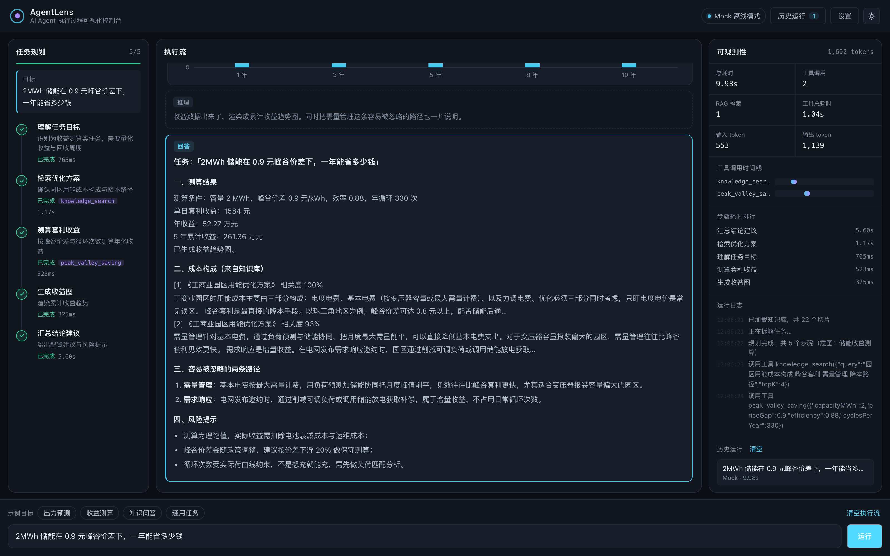
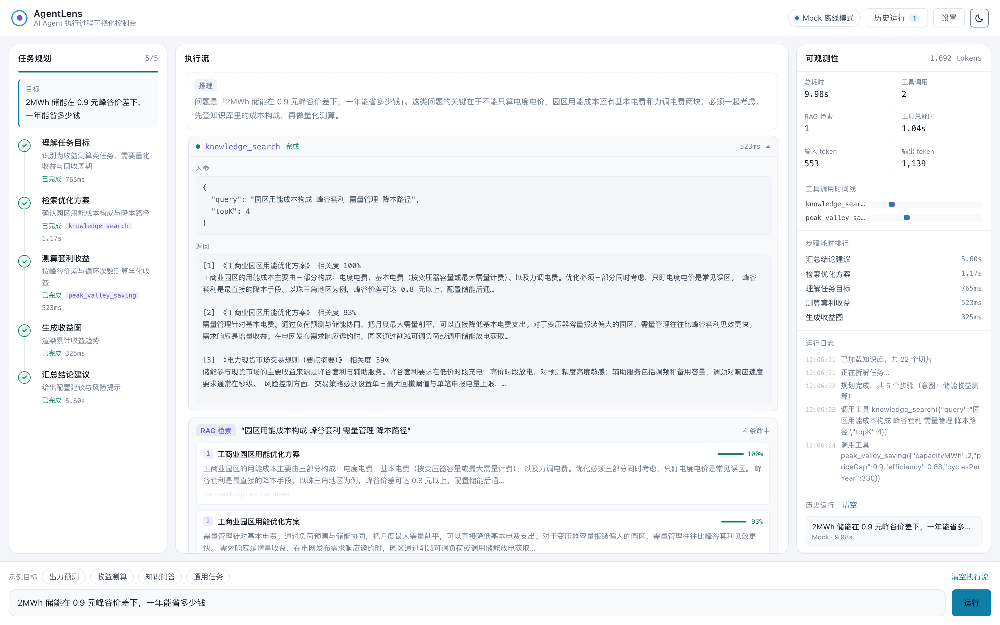

# AgentLens · AI Agent 执行过程可视化控制台

> 把「黑盒」的 Agent 调用变成可观察、可复盘、可解释的过程。
>
> 一个面向 AI 应用开发的**前端工程化**项目：规划可视化 + 工具调用链路 + RAG 检索可观测 + 执行流录制。

<p>
  
  
  
  
  
</p>

| 执行流 + 收益测算 | RAG 检索与工具调用链路 |
| :---: | :---: |
|  |  |

---

## 这个项目解决什么问题

做 AI 应用时，最痛苦的不是「调不通模型」，而是**调通了但不知道为什么**：

- 用户问了一个问题，模型答错了。是**检索没召回**？**提示词没说清**？还是**模型能力边界**？
- Agent 执行了 5 轮工具调用，中间哪一轮耗时最长？哪一轮参数传错了？
- 这次改完提示词效果变好了，**上一次的链路长什么样**？想对比，但没留证据。

大多数 AI 应用的界面只给一个输入框和一个回答框 —— 中间发生了什么，全靠猜。

**AgentLens 把中间过程全部摊开**：规划步骤、每一条推理、每一次工具调用的入参出参与耗时、RAG 命中的切片与相关度分数、token 消耗与端到端耗时，并且把整条链路录下来供复盘。

---

## 功能

### 1. 任务规划可视化
Agent 先把目标拆解成有先后顺序的步骤，每一步的状态（待执行 / 执行中 / 已完成 / 失败）实时更新，并标注该步骤绑定的工具与耗时。

### 2. 执行流实时渲染
推理过程与最终回答分开呈现，工具调用、RAG 检索结果、图表按**真实发生顺序**交织在主执行流里，而不是分散在几个面板中。

### 3. RAG 全链路可观测
- 文档 → 切分（段落优先 + 长度兜底 + 重叠）→ 建索引 → BM25 打分 → topK
- 每条命中展示：来源文档、切片 ID、相关度分数、命中上下文片段
- 支持上传自己的 `txt / md / csv / json`，索引立即重建

### 4. 工具调用链路
每个工具调用是一张可展开的卡片：入参 JSON、返回结果、执行状态、耗时。失败时红框高亮，错误信息直接可见。

### 5. 可观测性指标
总耗时、工具调用次数、RAG 检索次数、工具累计耗时、输入/输出 token、**工具调用甘特图**、**步骤耗时排行**、运行日志。

### 6. 双运行模式
| 模式 | 特点 | 适用场景 |
| --- | --- | --- |
| **Mock 离线** | 无需 API Key、结果确定可复现、完全离线 | 演示、自测、录屏 |
| **真实模型** | 接入任意 OpenAI 兼容接口 | 真实业务验证 |

> 关键设计：Mock 模式调用的是**真实工具实现**，所以检索分数、计算结果、图表数据都是真实产生的，只有「模型措辞」是模板化的。

### 7. 运行记录与复盘
每次运行结束后自动归档完整事件序列，点击可还原当时的执行现场。

### 8. 深色 / 浅色主题
通过 CSS 变量切换，图表配色同步跟随。

---

## 快速开始

```bash
git clone https://github.com/<your-name>/agent-lens.git
cd agent-lens
npm install
npm run dev
```

打开 http://localhost:5173 即可。**默认是 Mock 模式，不需要任何 API Key。**

### 接入真实模型

点击右上角 **设置** → 运行模式选「真实模型」，填入：

| 字段 | 示例 |
| --- | --- |
| Base URL | `https://dashscope.aliyuncs.com/compatible-mode/v1` |
| API Key | `sk-xxxxxxxx` |
| 模型名 | `qwen-plus` |

只要服务商兼容 OpenAI 的 `/chat/completions` 协议就能用，例如：阿里百炼、DeepSeek、Moonshot、智谱、本地 Ollama、vLLM。

> API Key 仅保存在浏览器 `localStorage`，不会上传到任何服务器。
> 如果服务商未开放浏览器 CORS，可使用仓库内 `api/llm-proxy.ts` 代理（见下方「部署」）。

---

## 架构设计

### 核心：Agent 运行时是一个异步事件流

```
runAgent(goal, ctx) : AsyncGenerator<AgentEvent>
```

规划、推理、工具调用、检索、流式 token 全部以事件形式抛出。UI 只做一件事：把事件渲染出来。

这个设计带来三个直接收益：

1. **UI 与推理内核完全解耦** —— 换成别的推理后端，前端一行不用改
2. **事件流天然可录制** —— 存下来就是一条可回放的链路
3. **中断干净** —— `AbortSignal` 在任意 `await` 点都能退出

```
src/
├── agent/                 推理内核（与 React 完全无关，可独立复用）
│   ├── types.ts           AgentEvent / PlanNode / ToolCall / ChartSpec 等契约
│   ├── corpus.ts          内置示例知识库
│   ├── retrieval.ts       切分 + BM25 检索
│   ├── tools.ts           工具注册表（新增工具只改这里）
│   ├── planner.ts         Mock 规划器 + LLM 规划器
│   ├── llm.ts             OpenAI 兼容协议适配层
│   └── runtime.ts         Agent 运行时（事件流）
├── hooks/
│   └── useAgentRun.ts     事件 → 状态，中断控制，耗时计时
├── components/            纯展示组件
└── state.tsx              useReducer + Context 状态层
```

### 一次运行的完整链路

```
用户输入目标
   ↓
① 规划          planner 产出 PlanNode[]           → plan 事件
   ↓
② 逐步执行      每步设 running / done              → node_status 事件
   ├─ 推理       流式吐出推理文本                    → message_start / message_delta
   ├─ 工具调用   入参出参 + 耗时                     → tool_call / tool_result
   ├─ RAG 检索   命中切片 + 相关度                   → retrieval 事件
   └─ 数据可视化 工具返回结构化数据，UI 自动绘图      → chart 事件
   ↓
③ 汇总回答      流式输出最终答案                    → message_delta
   ↓
④ 计量          输入/输出 token                    → usage 事件
   ↓
⑤ 归档          完整事件序列存入历史               → run_end 事件
```

---

## 设计取舍

这些取舍是刻意的，也欢迎讨论：

**① 为什么用 BM25 而不是向量检索？**
向量检索需要 embedding 模型，要么依赖后端、要么依赖 API Key，会让「clone 下来就能跑」这个目标失效。BM25 是纯计算、零依赖的，中文场景按二元组切分效果可接受，足以让使用者看清「检索 → 排序 → 拼装」这条链路。**生产环境应替换为「向量粗召 + 重排序」的两阶段链路**，接入点就是 `retrieval.ts` 的 `search()`。

**② 为什么内置一份语料？**
一个 RAG Demo 如果必须先上传文档才能体验，门槛就太高了。内置语料让项目开箱即用，同时支持覆盖。

**③ 为什么自己写 Markdown 渲染器？**
只支持标题、列表、粗体、行内代码四种语法。为四种语法拉进 `marked` + `dompurify` 两棵树不划算，自己实现反而让渲染逻辑本身成为可读示例。

**④ 为什么不用 Redux / Zustand？**
AgentLens 的状态变化几乎全部来自单一来源（Agent 事件流），`useReducer` 已经足够，且能让使用者一眼看懂数据怎么流动。依赖表里只有 `react`、`react-dom`、`echarts` 三个运行时依赖。

**⑤ 为什么 echarts 按需引入？**
`import * as echarts from 'echarts'` 会把所有图表类型打进包里。本项目只用折线和柱状，通过 `echarts/core` + 按需注册可以省掉一半以上体积。

---

## 如何扩展

### 新增一个工具（3 步）

```ts
// 1. 在 src/agent/tools.ts 实现 ToolDefinition
const myTool: ToolDefinition = {
  name: 'my_tool',
  description: '写清「什么时候调用」，而不只是工具名 —— 这直接影响模型选择准确率',
  parameters: {
    type: 'object',
    properties: { query: { type: 'string', description: '查询内容' } },
    required: ['query'],
  },
  async run(args, ctx) {
    return { text: '返回给模型的文本结果' }
  },
}

// 2. 注册
export const TOOL_REGISTRY = [..., myTool]
```

3. 完成。运行时、UI、真实模型的 tools 声明会自动包含它。

### 换一个推理后端

只需重写 `src/agent/runtime.ts` 里的对应函数，保持 `AsyncGenerator<AgentEvent>` 契约不变，整个界面无需改动。

### 替换检索方案

改写 `src/agent/retrieval.ts` 的 `search()`，返回 `RetrievalHit[]` 即可，UI 会自动渲染新的相关度分数。

---

## 部署

### 静态部署（推荐，Mock 模式足够演示）

```bash
npm run build
```

产物在 `dist/`，可部署到 Vercel / Netlify / Cloudflare Pages / GitHub Pages。

```bash
npx vercel --prod
```

### 需要代理时

若模型服务未开放浏览器 CORS，在 Vercel 项目设置中添加环境变量：

```
LLM_BASE_URL=https://dashscope.aliyuncs.com/compatible-mode/v1
LLM_API_KEY=sk-xxxxxxxx
LLM_MODEL=qwen-plus
```

`api/llm-proxy.ts` 会自动注册为 Edge Function。然后在前端设置里把 Base URL 改成 `/api/llm-proxy`。

---

## Roadmap

- [ ] 接入向量检索（embedding + 重排序）
- [ ] 导出单次运行链路为 JSON / 图片，便于贴进 issue
- [ ] 多轮对话模式（当前为单次任务执行）
- [ ] 提示词 A/B 对比：同一目标跑两套提示词，并排比对链路
- [ ] 评测集与自动化回归

---

## License

MIT
